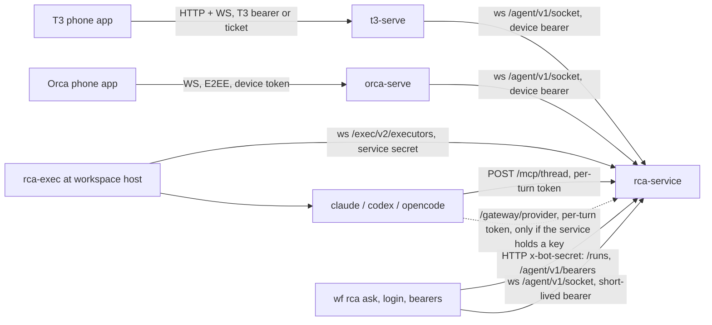
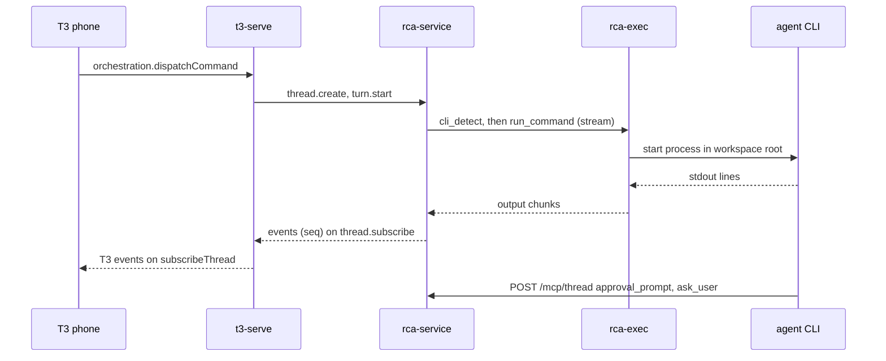
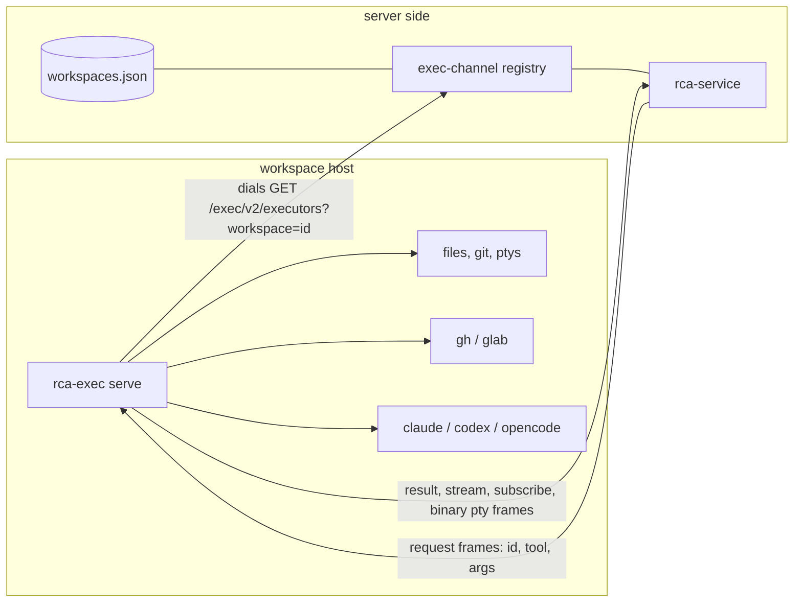
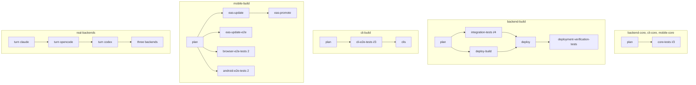

# rca: how the data flows, what tests it, which CI job runs the test

Companion to `rca-service-executor-and-mappers.md` (who owns what). This doc adds the full data flow, the test map and the CI map. Facts were read from code, `Cargo.toml` metadata, workflow files and the output of `wf ci plan tests --all --json` at commit b6c31322. Nothing here is a run result. Counts are test attributes (`#[test]`, `#[tokio::test]`), not passes. A fact that could not be established says so.

## 1. What rca is, and the words

rca is the Remote Chat Agent: a phone app sends a chat message, a server runs an agent CLI (claude, codex or opencode) on a project's machine, and the events stream back to the phone.

Two different things are called rca. Keep them apart:

- **rca service**: the server `backend/remote-chat-agent` (package `rca-service`). It is the hub.
- **rca CLI**: `clis/rca`, the command line behind `wf rca ask`, `compare` and the model ladder. It is a client of the service's old `/runs` route. It is not on the phone path.

**orca is not rca.** Orca is a third-party phone app. `orca-serve` is our server that speaks Orca's protocol and calls the rca service.

| Word | Meaning |
| --- | --- |
| service | `rca-service`. Threads, turns, history, approvals, the executor registry. It never runs a turn's CLI and never connects out to a mapper or an executor. |
| executor | `rca-exec` (`clis/rca-exec`). Runs at the workspace host. Dials INTO the service. Runs commands, files, git, ptys, logins, mcp and hosted (gh/glab) actions. |
| mapper | A phone-protocol server that is a client of the service: `t3-serve` (T3 app) and `orca-serve` (Orca app, `orca-map-*` crates). |
| agent CLI | `claude`, `codex` or `opencode`, started by the executor on the service's instruction. |
| workspace | A name for one project root, not a machine. One `rca-exec serve --workspace <id> --root <dir>` serves one workspace. |
| cassette | A recorded session of a real reference server (T3 at v0.1.9, Orca at v1.4.259): the phone's calls and the real answers. |
| replay | `wf-mimic` plays a cassette against our mapper over the real chain and labels each answer clean, allowlisted, drift or breaking. |
| scripted CLI | The test double from `exec-testkit` that stands in for the agent CLI in every test that is not a real-agent test. |

Other pieces: `libraries/agent-api` holds the contracts (`agent-api-*` for the phone-facing API, `exec-*` for the executor channel) and `agent-api-client`, the client the mappers use. `clis/rca-exec` is the executor binary. `clis/mimic` and the `mimic-*` crates are the record and replay machinery.

## 2. Data flow

### 2.1 Who dials whom



Every arrow is a client-to-service connection. The service never dials a mapper or an executor. The only outbound calls from the service are to model APIs through the gateway and to its opencode server.

The service has two engines. The phone path uses only the agent-API engine (`thread_engine`, state under `<RCA_STATE_DIR>/agent-api`). The older thread-view engine (`orch`) serves `/ws`, `/api/control/*`, `/api/question/*` and `/runs`.

### 2.2 One T3 message, end to end



1. **Pair.** `t3-serve t3 pair` mints a one-time code (only its SHA-256 is stored). `POST /oauth/token` swaps it for a bearer with T3 scopes. `POST /api/auth/websocket-ticket` gives a one-use ticket. `GET /ws?wsTicket=...` opens the RPC socket (426 without protocol 2, 401 without a ticket). The phone credential is T3's own, never an rca credential.
2. **Dispatch.** `orchestration.dispatchCommand` goes to the decider in `t3-core`, which writes T3 events to SQLite and makes a launch. The runner waits up to 5 s for the provider to open.
3. **t3-serve calls rca.** `RcaAgent` (`clis/t3-serve/src/adapters/rca.rs`) takes `T3_RCA_URL` as `http://host:port` (any other scheme is refused at startup) and opens `ws://host:port/agent/v1/socket` through `agent-api-client` with `Authorization: Bearer <T3_RCA_BEARER>`. Each call opens its own socket, so an interrupt never waits behind the turn it stops. It sends `thread.create`, then `turn.start {thread, workspace, driver, model, prompt, runtime_mode, interaction_mode, attachments}`. The workspace is the single `T3_RCA_WORKSPACE`. It stores the links `agent-turn:`, `agent-run:` and `agent-seq:` in its `meta` table.
4. **Service front door.** `agent_socket_bearer` accepts a device bearer and refuses the service secret. One JSON frame per request goes to `AgentApi::dispatch`, which finds the group by method name. Groups are registered once in `agent_api()` in `rs/src/lib.rs`.
5. **`turn.start`** (group `agent.threads`). Refusals in order: unknown driver, no executor for the workspace (`NO_EXECUTOR`), a turn already running (`TURN_RUNNING`). Then `cli_detect` at the executor (`CLI_NOT_INSTALLED` if absent). Attachments are staged into the workspace first. The service records `turn.started` and the user's message, takes a git checkpoint through the executor, builds the command and starts it.
6. **Command.** `cli-driver` builds the non-interactive call of `opencode run --format json`, with the service's MCP server in an env config, and may route it through the model gateway when the service holds a key for that provider. Claude Code has no command: it is a live `claude -p --input-format stream-json` process for each thread (`session_open` with the thread's own flags: conversation, permission mode, model, `--mcp-config` of the service's tool server with the thread's bearer), a turn is a user message with its own uuid ended by the `result` frame that names it, a steer is a message with priority `now`, an interrupt, and the permission and question requests of the CLI (`can_use_tool`) are answered on that process; a changed mode or model is a control request, an idle process is closed and the next turn resumes the conversation by its id (`docs/solutions/architecture/claude-code-stream-json-protocol.md`); it is not routed through the gateway. Codex has no command: it is a live `codex app-server` per workspace (`session_open`), and a turn is `thread/start` or `thread/resume` and `turn/start` on it; its approvals are answered on that process and it is not routed through the gateway.
7. **Run over the channel.** `HostSpawner` sends executor action `run_command` with `exec '<prog>' ... < /dev/null`, a 6 h timeout and the workspace as cwd, and reads the streamed chunks as lines. The executor starts the CLI with the host's own credentials.
8. **Lines become events.** `cli-driver` translates each line (`Text`, `Reasoning`, `ToolStarted`, `ToolFinished`, `Error`) and catches the CLI's own session id. The group maps them to `message.delta`, `reasoning.delta`, `tool.started`, `tool.output`, `tool.finished`, `file.changed` and `error`. The engine gives each a `seq` and appends it to `<state_dir>/agent-api/threads/<id>/events.ndjson`. At the end it records `turn.finished {completed|failed|interrupted}` and starts the thread's next queued prompt.
9. **Push.** `thread.subscribe` replays after `after_seq` then follows live, with no gap and no duplicate. A stalled peer (queue of 4096) is closed and resumes from its last `seq`.
10. **Back to the phone.** `RcaAgent::follow` feeds the runner, which folds each agent event once (a receipt is stored) into a T3 event row. The engine publishes it to the phone's `orchestration.subscribeThread` stream.
11. **Approvals.** The CLI calls `POST /mcp/<thread>` (admitted from loopback, or with the turn's token). The only tools are `approval_prompt` and `ask_user`. The service records `approval.requested` in the thread log, blocks, and unblocks on `approval.answer`.

An Orca message follows the same path from step 3 on. Orca's differences: the phone link is an E2EE WebSocket (`e2ee_hello`, `e2ee_ready`, then `e2ee_auth {deviceToken}`; close codes 4001, 4002, 4003); a session is an rca thread and the session id is the thread id; retries are made idempotent by a ledger in rca's `state` group (`session-op.<session>`); events are polled with `thread.subscribe` / `thread.history` and the phone's cursor is rca's `seq`. The credential is `ORCA_RCA_BEARER`.

### 2.3 The executor channel



- **Dial.** `rca-exec serve --rca-url http://svc:8787 --workspace <id> --root <dir>` opens `ws://<authority>/exec/v2/executors?workspace=<id>[&executor=<id>]`. Plain `http://` or `ws://` only, no TLS. It runs an I/O thread plus 8 workers.
- **Auth.** The executor presents the service secret `CHAT_AGENT_API_SECRET`. A device bearer does not open the channel; the service secret does not open `/agent/v1/socket`. A unit test in `rs/src/api/auth.rs` pins that.
- **Registry.** A workspace owned by another executor gets 409 `WORKSPACE_TAKEN`. A second socket for the same executor id replaces the first (close code `REPLACED`, and `rca-exec` does not reconnect after it).
- **Loss.** When the channel closes, pending actions fail `EXECUTOR_GONE` and a running turn ends `failed`. `--reconnect` retries from 200 ms to 5 s for `--reconnect-for` (default 900 s). Ptys and processes do not survive a reconnect.
- **Actions** (`libraries/agent-api/exec-*`): `exec-proc` (run_command, cancel, cli_detect, proc_sample, mcp_request, login_*), `exec-fs`, `exec-git`, `exec-pty`, `exec-hosted`, `exec-preview`, `exec-browser`, frames in `exec-proto`.
- **No scopes at rca.** A device bearer is `{id, label, created_at}`. Any valid bearer may call any registered method. Scopes exist only in T3's own pairing (17 scopes).
- **Bearer admin.** `POST/GET /agent/v1/bearers`, `DELETE /agent/v1/bearers/{id}` need the service secret. `wf rca bearers mint|list|revoke`. A token is `rcab_` plus 64 hex characters; only a SHA-256 digest is kept.

### 2.4 Other flows, in one line each

- **Attachments.** The phone gets a signed upload URL from t3-serve and uploads to it. t3-serve calls `upload.put`. The service stores bytes under `attachments/<id>` and, on `turn.start`, writes them into the workspace through the executor.
- **Terminals.** `terminal.open` calls executor `pty_open`/`pty_attach`; output returns as binary frames with a byte offset; a pump re-attaches from its offset after a channel replace.
- **Hosted (gh/glab).** `hosted.*` groups call `exec-hosted` actions at the executor. The service holds no token.
- **Provider logins.** `login_start` / `login_send` run at the executor. `wf rca login` uses a short-lived device bearer.
- **Schedules.** The service ticks every 5 s, and a due schedule calls `thread.create` and `turn.start` as a mapper would. A webhook route (`/hooks/v1/schedules/{id}/{token}`) is authorised by the schedule's own token.
- **Guest share (T3 only).** Records a guest message as a T3 event. It makes no rca call. Live stream, page and uploads are marked "not built" in code.
- **`wf rca ask`.** `clis/rca` posts `POST /runs` with `x-bot-secret`. The service runs the ladder against its opencode server. This is the old path through `rca-core` and `rca-ladder`: not the agent API, not the executor.

### 2.5 Where state lives

| What | Where | Medium |
| --- | --- | --- |
| Threads, turns, history (agent-API engine) | service, `<state_dir>/agent-api/threads/<id>/events.ndjson` plus snapshots and `index.json`; memory only if `RCA_STATE_DIR` is unset | files |
| Queue, approvals, questions, lifecycle | in the thread's event log | files |
| Pending approval waiters, "allow for session" grants | service, in the runner | memory |
| Device state (`state` group; Orca settings in scope `orca`) | service, `home/.local/state/rca/agent-state.json` | file |
| Device bearers (digests) | service, `home/.local/state/rca/device-bearers.json` | file |
| Schedules | service, `home/.local/state/rca/schedules.json` | file |
| Attachments (10 MiB cap) | service, `home/.local/state/rca/attachments/<id>` | files |
| Executor ownership and workspace places | service, `<state_dir>/agent-api/workspaces.json` | file |
| Panes, sleeping terminals | service, `<state_dir>/agent-api/panes.json`, `sleeping-terminals.json` | files |
| Terminal output tails, notifications, previews, gateway tokens | service | memory only |
| Ask sessions for `/runs` | service, `RCA_ASK_ROOT` | files, reaped hourly |
| T3 view of projects and threads, pairing, tickets, event dedupe | t3-serve, SQLite `<T3_STATE_DIR>/state.sqlite` | file |
| Orca host key, devices, runtime id | orca-serve, `<ORCA_STATE_DIR>/` | files |
| Orca settings, UI state, retry ledger | in the service's `state` group | file |
| Project files, agent CLI logins | workspace host (executor side) | the host's disk |

Restart behaviour:

- **Service restart.** A turn that was running is recorded `interrupted` with cause `restart` and never re-run. The thread's queue resumes after the executor reattaches, waiting up to 15 min. Pending approvals are lost. Schedules are recovered from file.
- **t3-serve restart.** `resume_runs` catches up from `thread.history` after the stored cursor, then follows each running run to its end.
- **orca-serve restart.** A cursor from another epoch is a reset. `agentSession.continueInterrupted` sends a new prompt.

### 2.6 Where each piece can run

| Piece | Runs | Reaches |
| --- | --- | --- |
| rca-service | the VM, container `remote-chat-agent-prod` beside tailscale, an opencode server and a speech sidecar | listens on `PORT` (8787) |
| t3-serve, orca-serve | the VM, separate compose projects, each with its own tailscale sidecar | the service by tailnet name; phones reach them over the tailnet only |
| rca-exec | any machine that can reach the service's `host:port`, with the agent CLIs installed and signed in; several per machine, several machines per service | the service |
| rca CLI | anywhere on the tailnet | the service's `/runs` |

Tests collapse all of this to loopback: `Chain::start` (`clis/t3-serve/tests/integration/rig.rs`) starts real `rca-service`, `rca-exec` and the mapper as processes, with a `Tap` between mapper and service and between executor and service.

## 3. Test map

Kinds, in the repo's own words:

- **unit**: in-crate `#[cfg(test)]`, ports doubled.
- **flow**: `--test flow`, Given/When/Then through the crate's public entry point, external dependencies doubled.
- **integration**: `--test integration`, built binaries run against each other. Includes replay.
- **replay**: integration against a cassette set, as Nx tasks `replay-*`.
- **cli e2e**: `tests/e2e.rs`, the binary against a real service and real opencode on loopback.
- **deployment verification**: real calls against the deployed service.
- **real-agent**: one real turn per agent CLI.

| Component | Kind | Real | Double | Command |
| --- | --- | --- | --- | --- |
| t3-serve | flow (274) | router over loopback socket, binary, SQLite | rca (`AgentApi` from contract fixtures, a stand-in rca), clock, ids | `cargo test -p t3-serve --test flow` |
| t3-serve | integration, per feature (8 tasks) | built t3-serve, rca-service, rca-exec, real git | scripted CLI, speech sidecar, fake gh/glab | `cargo test -p t3-serve --test integration -- replay_features::t3_core_<feature>::` (attachments, core, preview, pull_requests, schedules, terminal, vcs, workspace) |
| t3-serve | integration, residual (36) | same chain | same | same binary with `--skip replay_features::`. Covers chain, attachments, checkpoint_rollback, guest_share, real_agent_turn, scripted_turn_replay, terminal_pty, thread_surface, voice. |
| t3-contracts, t3-core | unit (41, 61) | pure rules | none | `cargo test -p <crate> --lib` |
| t3-http, t3-store | none found | | | clippy only |
| orca-serve | flow (50) | transport over loopback, thin binary | rca (fake agent API) | `cargo test -p orca-serve --test flow` |
| orca-serve | integration, 12 replay tasks plus residual (25) | built orca-serve, rca-service, rca-exec; headless Chromium for browser tests | scripted CLI, fake speech sidecar | `--test integration` filtered `replay_features::orca_core::` and `orca_map_<crate>::`; residual with `--skip replay_features::` (agent_catalog, agent_sessions, browser, interrupted, layout_vault, mimic_x2, mimic_x6, speech, terminal_artifacts, terminal_pty) |
| orca-serve | deployment verification (2) | deployed host: `/health` names the commit, a pre-paired phone handshakes and calls read-only `status.get`, a wrong token is refused | none | `--test deployed_verification -- --ignored` |
| orca-map-* | flow, unit | host dispatcher | scripted agent double | `cargo test -p <crate> --test flow` |
| orca-core, orca-crypto | flow (6, 17) | crypto vectors recorded by the pinned reference | none | `--test flow` |
| rca-service | flow (about 157, 3 ignored) | real router and `App::new`; sixteen modules (agent_threads, agent_terminal, agent_git, agent_hosted, agent_workspace, agent_workspaces, agent_catalog, agent_queue, agent_lifecycle, agent_schedules, agent_attachments, agent_browser, agent_preview, exec_remote, contracts, real_backends) also run real `rca-exec` and a temp git repo | FakeOpencode, FakeCommands, scripted spawner, fake clock, scripted model API, scripted CLI; replay gh/glab | `pnpm --filter @app/remote-chat-agent run test:flow` = `cargo test -p rca-service --test flow --test log_lines` |
| rca-service | contract replay | every agent-api and exec fixture over real WebSockets, actions checked against the declared table | none | inside `tests/flow/contracts.rs` |
| rca-service | integration (1) | `wf-mimic` replays the voice-edit DSL cassette | cassette | `test:integration` = `cargo test -p rca-service --test integration` |
| rca-service | deployment verification | deployed service: `/runs` with a real model; with `WF_DEPLOYED=1` one real turn per provider in `RCA_VERIFY_WORKSPACE` | none | `test:verify:deployed` |
| rca-service | real-agent (3, ignored) | pinned CLI binary and its credential, real rca-exec, real service, temp repo | none | `cargo test -p rca-service --test flow <real_backends test> -- --ignored` |
| service crates (agent-core, cli-driver, core, exec-channel, service-core, host, opencode, render, speech, group-agent, -workspace, -state, -accounts, -terminal, -git, -hosted, -schedules, -gateway, -attachments, -catalog, -preview) | unit | in-process | testing-feature ports | package `test:unit` = `cargo test ... --lib` over those crates |
| rca-exec | flow (154) | local adapter, temp dirs, processes, real git, pty | the service (an in-test WebSocket server). `contracts.rs` replays exec fixtures frame by frame. | `cargo test -p rca-exec --test flow` |
| rca-exec | unit (27) | | | `cargo test -p rca-exec --lib` |
| exec-* contract crates | unit | self-consistency of authored fixtures | | `cargo test -p <crate> --lib --manifest-path libraries/agent-api/Cargo.toml` |
| agent-api-* contract crates | unit | self-consistency of authored fixtures (hand-written, so they cannot prove parity) | | same |
| agent-api-client | flow (15) | client | in-process fake agent API server (wrong bearer, dropped socket, replay overlap) | `--test flow` |
| agent-api-proto, agent-api-attachments | integration (2, 1) | `wf-mimic` replay against the crate's driver; masks match `wf mimic record` | | `--test integration` |
| exec-testkit | flow (33), unit (11) | scripted CLI as a process, real git | | `--test flow` |
| rca CLI | flow (20) | binary argv | opencode, git, pnpm, pricing stubbed; vm-ops-api behind a fake tailnet | `cargo test -p rca --test flow` |
| rca CLI | cli e2e (65 tests, 4 Nx tasks) | real rca-service and real `opencode serve` on loopback | `ask` uses a scripted model; the `compare` groups need `OPENCODE_GO_API_KEY` | `--test e2e ask::`, `compare::`, `compare_features::`, `compare_capabilities::` |
| rca-core, rca-ladder | flow (3, 1) | golden JSON replay | | `cargo test -p rca-core --test flow --manifest-path libraries/Cargo.toml` |
| wf-mimic, mimic-* | flow, unit | | in-memory doubles, fake sidecar, fake t3 | `--test flow` per crate |
| every CLI and library crate | clippy | | | `cargo clippy --all-targets -D warnings` (79 plan entries: clis 52, libraries 26, backend 1) |

What is real and what is double, in short:

- **Real**: the chain of binaries (mapper, service, executor, git) in the integration tests.
- **Double**: the agent CLI. Every test except the real-agent ones, the `compare` e2e groups and the deployed per-provider turns uses the scripted CLI. Its recordings are `imported` from CLI docs, not recorded from a real CLI (`docs/gaps/exec-testkit-recordings-not-from-real-clis.md`, open).
- **Cassettes**: T3 sets are recorded from the real T3 server at 0.1.9 (10 sets, listed in t3-serve's `[package.metadata.integration.replay]`). Orca sets `orca-v1.4.259-recorded` and `-crawl` are replayed against `orca-serve`. `exec-hosted` is `imported`; `exec-hosted-projects` is `recorded` against a real GitHub account. `mimic_x6` uses a scripted host as its reference, so its cassette is `authored` and serves no parity row.

## 4. CI map

All six per-push workflows are thin callers of the reusable `.github/workflows/pipeline.yml`. Each runs on `push` to `dev` only, has a `trigger` job (skipped when `vars.HOSTED_CI == 'off'`; starts nothing for an empty commit unless the message carries `[services:` or `[cache:`) and a `run` job that calls the pipeline.

| Workflow file | Workflow name | `stages` | Jobs it can run | Shards | When |
| --- | --- | --- | --- | --- | --- |
| `ci-hosted-backend-core.yml` | backend_core+lint+pre-release-testing | core, area backend | `core-tests` (flow, typecheck-lint-unit) | 3 | push to dev |
| `ci-hosted-cli-core.yml` | cli_core+lint+pre-release-testing | core, area cli | `core-tests` | 3 | push to dev |
| `ci-hosted-mobile-core.yml` | mobile_core+lint+pre-release-testing | core, area mobile | `core-tests` | 3 | push to dev |
| `ci-hosted-backend-build.yml` | backend_build+deploy+release-testing | deploy | `integration-tests`, `deploy-build`, `deploy`, `deployment-verification-tests` | 4 | push to dev; deploy only if `vars.HOSTED_DEPLOY == 'on'` |
| `ci-hosted-cli-build.yml` | cli_build+publish+release-testing | cli | `clis`, `cli-e2e-tests` | 3 | push to dev; deploy only if `HOSTED_DEPLOY == 'on'` |
| `ci-hosted-mobile-build.yml` | mobile_build+publish+release-testing | e2e | `eas-update`, `eas-update-e2e`, `browser-e2e-tests`, `android-e2e-tests`, `eas-promote` | 1 (caller), 2 per e2e job | push to dev |
| `cold-ci.yml` | Cold CI | all, no cache | all but deployment verification and e2e | 6 | Sunday 03:37 UTC, or manual, on `main` or `dev` |
| `real-backends.yml` | Real backends | n/a | `turn (claude)`, `turn (opencode)`, `turn (codex)`, aggregate `three backends` | 3 legs, sequential | push to dev that changes `backend/remote-chat-agent/**`, `clis/rca-exec/**`, `libraries/agent-api/**`, `tooling/real-backends/**` |
| `mimic-record.yml` | Mimic record | n/a | `plan`, `capture` (one set at a time, 240 min), `codex-login-writeback` | 1 | empty dev commit tagged `[record <set>]` or `[replay <set>]`, routed by `scheduled-triggers.yml` |
| `track-contracts.yml` | Track contracts | n/a | `plan`, `capture`, `drop-checkpoints`, `report` | 1 | daily 02:23 UTC, or manual |
| `image-build-probe.yml` | Image build probe | n/a | docker build of the t3-serve and orca-serve images | 1 | push to dev touching either Dockerfile, `libraries/agent-api/**`, `clis/wf-kit/**` or `clis/Cargo.lock` |
| `github-projects-record.yml` | GitHub projects record | n/a | `record` of the `hosted_project_*` executor actions | 1 | push to dev touching itself or `clis/mimic/src/projects_verb.rs` |
| `ci-audit.yml` | CI audit | n/a | `audit` of the last 24 h of the six callers | 1 | daily 02:23 UTC, Sundays 03:37 UTC, or `[ci-audit]` empty commit. Never gates a push. |

`pipeline.yml` jobs, by stage:

| Stage | Job | Tests | Shard layout |
| --- | --- | --- | --- |
| flow-tests and typecheck-lint-unit-tests | `core-tests (i/N)` | every package's `test:flow`, `typecheck`, `lint`, `test:unit`; every crate's `tests/flow.rs`, inline unit tests and clippy | shard `i` runs flow shard `i` and typecheck shard `N+1-i` |
| integration-tests | `integration-tests (i/N)` | every `test:integration` and `tests/integration.rs`, including the `replay-*` Nx tasks of t3-serve and orca-serve | dealt by `shard-weights.json`; shards proven on the same inputs get no runner |
| cli-e2e-tests | `cli-e2e-tests (i/N)` | crates' `tests/e2e.rs` (the rca CLI groups) | same |
| deployment-verification-tests | `deployment-verification-tests` | `test:verify:deployed` and `tests/deployed_verification.rs` | one job; runs only for the dev head after a successful `deploy` and, when `ship` is set, a successful `clis` (see 6.3 item 9) |
| browser-e2e-tests, android-e2e-tests | via `e2e-tests.yml` | focused `e2e/*.lua` tests | 2 each |



The diagram shows the jobs each caller can run. The full `needs` edges, including the cross-job gates, are in `pipeline.yml`.

How a test becomes a job:

- `plan` runs `wf ci plan tests --changed --base last-green`. The base is the newest `dev` ancestor whose run of the same caller file succeeded. A package or crate is planned if it owns a changed file or depends on one that does. `--area` filters by directory: `clis/*` is cli, `.` and `frontend/*` is mobile, everything else (including `backend/*`, `libraries/agent-api`, `libraries/rca-core`) is backend.
- Commit tags: `[ci:flow,unit,service,browser,android]` limits job families; `[services:all|changed|names]` forces tests and ships; `[cache:no]` runs fresh.
- Every test stage replays through the Nx cache. A task whose inputs are unchanged replays its last pass.
- Never skipped as proven: a shard with a pnpm package, a crate with a `package.metadata.flow` or `package.metadata.integration` table, and a crate whose tests spawn docker, `wf`, opencode, mimic, node, ffmpeg, chromium or java. t3-serve and orca-serve are therefore always run.
- orca-serve carries `integration.evidence`, so its chain is planned on every push while its coverage table has pending rows.

The local gate, `wf check --staged` in lefthook pre-commit, runs affected typecheck, unit and flow tests only for staged `.ts .tsx .mts .cts .js .mjs .cjs .json` files. A staged `.rs` file triggers no rca crate test at commit time; the always-run `workflows` job (`crate-pipeline:cargo-flow`) and the `secrets` flow test (only when its registry files are staged) are the only Rust tests in pre-commit. A Rust-only change to rca first gets its tests in CI (plus the architecture scan, layout and workflow checks at commit time). The `post-land` hook runs `cargo test --workspace` in `clis/` but is not part of commit.

## 5. Where does a change get tested

"First job" is the earliest CI job whose plan entry covers the change, by the rules in section 4. The caller named is the one whose `area` or `stages` includes it.

| Change to | First CI job that would catch it | Then |
| --- | --- | --- |
| `clis/t3-serve` (any crate) | `core-tests` in `ci-hosted-cli-core.yml`: t3-serve flow, t3-core and t3-contracts unit, clippy | `integration-tests` in `ci-hosted-backend-build.yml` (chain and `replay-t3-core-*` tasks); `image-build-probe.yml` if the Dockerfile changed |
| `clis/orca-serve` or an `orca-map-*` crate | `core-tests` in `ci-hosted-cli-core.yml`: that mapper's flow tests, orca-serve flow | `integration-tests` (chain and `replay-orca_*` tasks); `deployment-verification-tests` only with a deploy |
| an rca-service group (`rca-group-*`) | `core-tests` in `ci-hosted-backend-core.yml`: package `test:unit` (the crate's own tests) and `test:flow` | `integration-tests` for t3-serve and orca-serve if their `uses` reach it (see the hole in 6.4); `real-backends.yml` (path match) |
| `rca-service` itself (`rs/`) | `core-tests` in `ci-hosted-backend-core.yml`: `test:flow` | `real-backends.yml`; `integration-tests` (voice-edit replay and the mapper chains) |
| `clis/rca-exec` | `core-tests` in `ci-hosted-cli-core.yml`: rca-exec flow and unit | the service flow modules that start the real binary; mapper chains in `integration-tests`; `real-backends.yml` |
| `clis/rca` or `libraries/rca-core` | `core-tests` (cli-core for `clis/rca`, backend-core for `rca-core`): rca flow, rca-core and rca-ladder flow | `cli-e2e-tests` in `ci-hosted-cli-build.yml` (rca groups) |
| an agent-api or exec contract (`libraries/agent-api/*`) | `core-tests` in `ci-hosted-backend-core.yml`: the crate's unit tests, clippy, and the flow of every crate that depends on it (agent-api-client, exec-testkit, and through cargo dependencies the service and mappers) | `integration-tests`; `real-backends.yml` and `image-build-probe.yml` (path match) |
| `libraries/agent-api/agent-api-proto` or `-attachments` | `integration-tests` for the crate's own replay, after `core-tests` | |
| a cassette set | no push workflow tests cassette content as a replay. The staged gate runs `wf mimic verify --all` for a staged cassette file. The replays run in `integration-tests` when a mapper is reached. | `mimic-record.yml` with `[replay <set>]` replays a set on demand; `track-contracts.yml` re-records on drift |
| `clis/mimic` or a `mimic-*` crate | `core-tests` in `ci-hosted-cli-core.yml`: `wf-mimic` flow (191) | `integration-tests` because the replay driver is used there |
| `exec-testkit` or the scripted CLI | `core-tests`: its flow, plus a rerun of the flow entries that list it in `uses` (rca-service, rca-exec, t3-serve, orca-serve) | `integration-tests` |

I did not run the planner for each row, so "first job" follows from the rules above, not from a plan output per change. To check one, run `wf ci plan tests --changed --base <sha> --sha <sha> --json` on the change.

## 6. Known holes

Stated plainly. "Not established" means the researchers did not find the answer in the repo.

### 6.1 Never tested, or only with a double

1. **The real agent CLIs on the phone path.** The t3 and orca chains use the scripted CLI. Real CLIs run only in `real-backends.yml` (one prompt and one file write each, no mapper), the `compare` e2e groups, and the deployed per-provider turns. `real_agent_turn.rs` can drive real CLIs, but its header says only the scripted run is verified and no real-CLI run has passed.
2. **Scripted CLI output is imported, not recorded.** Open gap `docs/gaps/exec-testkit-recordings-not-from-real-clis.md`.
3. **t3-serve has no deployment verification.** The plan has no entry. orca-serve has one.
4. **Deployment verification is inactive without a deploy.** With `deploy: false` the plan lists every leg as changed, so the job's `if` fails. Whether `vars.HOSTED_DEPLOY` is `on` cannot be read from the repo. The workflow comment says there has been no VM since 13 Nov.
5. **Contract fixtures are authored.** The `agent-api-*` and `exec-*` fixtures prove self-consistency, not parity with any real server.
6. **The tests collapse the network.** Everything runs on loopback. The tailnet, the separate compose projects and the real `AGENT_PUBLIC_URL` path are not tested.
7. **Orca terminal rows.** The headless Orca host answers "no open app window", so terminal behaviour is covered by a separate behaviour test, not a cassette.
8. **Cassette sets with no planned replay.** `orca-v1.4.259-files` and `-scenarios` exist but are not in the integration replay `sets` list. `-files` is used by orca-serve's `mimic_x6` integration test (`SUITE = "wf-mimic-orca-files"`), which the residual filter (`--skip replay_features::`) runs. `-scenarios` is named in `clis/mimic/script/core/tests/flow.rs`; what asserts against orca-serve with it was not traced.
9. **Guest share.** The code records a guest message and makes no rca call. How a pending guest message becomes a turn was not traced.
10. **Approvals for opencode.** Claude Code's approvals are `can_use_tool` requests of its live process (`--permission-prompt-tool stdio`), Codex's come from its server's own requests (`approval.requested`, answered on the live process); opencode has none. How T3 and Orca runtime modes map to approvals for opencode was not traced.
11. **No scopes at rca.** Nothing tests per-device authorisation because none exists.

### 6.2 Tests that exist but no planned command runs

- `rca-group-browser` (4 unit tests) is not in the package's `test:unit` list.
- `rca-service`'s own 21 in-source unit tests are not selected: `test:unit` omits `-p rca-service` and `test:flow` runs only `--test flow` and `--test log_lines`.
- `orca-map-terminal/tests/stream.rs` (31 tests): only `flow.rs`, `integration.rs`, `e2e.rs`, `deployed_verification.rs` and `nx_contract.rs` get Nx tasks.
- `rca-core/tests/time_vectors.rs` (4 tests) and `rca-ladder/tests/ords.rs` (4 tests) are not selected.
- No tests found for `t3-http`, `t3-store` and `mimic-plan-core` (clippy only).
- The Rust crates under `backend/remote-chat-agent` have no clippy entry in the plan. Another clippy gate was not established.

### 6.3 CI gaps

1. **Split gates are partly empty.** `eas-promote` accepts `success` or `skipped` from the test jobs. In `ci-hosted-mobile-build.yml` (`stages: e2e`) those jobs are skipped, so the pointer can move without waiting on tests that run in other workflows. `deploy` in backend-build waits only for that run's integration tests.
2. **`clis` runs only with `deploy`** (`inputs.ship && inputs.deploy`, and only in `ci-hosted-cli-build.yml` or a run with `stages: all`), so the `wf-latest` release (the source of the `rca-exec` binary) is skipped while `HOSTED_DEPLOY` is off.
3. **A Rust-only change gets no test at commit.** See section 4.
4. **Pre-push gate is not wired.** `wf check --pushed` exists; `lefthook.yml` has no pre-push job.
5. **Stale comments.** `cold-ci.yml`'s header says it "deploys, ships and runs no device suite" while `deploy` and `ship` are false. `clis/pipeline/tests/flow/caller_drift.rs` names two callers; there are six.
6. **real-backends internals.** `tooling/real-backends/run_leg.py` and `aggregate.py` were not read, so what each leg asserts beyond the flow test's own assertions is not established.
7. **Browser and Android e2e.** The `rca-service` they start (`clis/pipeline/src/e2e_backends.rs`) has no `rca-exec` reference that was found. Only voice-edit and tamil-writing touch rca, through the old `/runs` path. They are app tests, not rca tests.
8. **Which integration job runs a mapper change** depends on `uses` in the mapper's `Cargo.toml` metadata. Whether every rca-service group change reaches the mapper chains through it was not checked per crate.
9. **`deployment-verification-tests` cannot run in backend-build.** Its `if` needs `needs.clis.result == 'success' || !inputs.ship`. Backend-build has `ship` true and `stages: deploy`, and `clis` is guarded to `stages` `all` or `cli`, so `clis` is skipped there and the job's condition fails. `clis` runs under `ci-hosted-cli-build.yml`, which does not run deployment verification. Whether the job runs in any push workflow was not established.

### 6.4 Facts not established

- **Where `rca-exec` runs in production.** No compose, cloud-init or infra file starts it. Which machine is the production workspace host, and with which `--workspace`, is not in code. `T3_RCA_WORKSPACE=main` is the only workspace name seen.
- **`AGENT_PUBLIC_URL` in production.** The service reads it, but `backend/remote-chat-agent/docker-compose.prod.yml` does not set it. Without it the MCP URL given to a remote CLI is a loopback address. Whether the executor shares the service's host, or the value is set elsewhere, is unknown.
- **Whether `backend/remote-chat-agent/docker-compose.prod.yml` is current.** It carries comments from the earlier Node service. Its values are indicative only.
- **`Ports.spawner`** (direct `Processes`) is built in `main.rs` and stored, but no non-test consumer was found. It may be dead wiring.
- **Two docs are partly stale.** `rca-service-executor-and-mappers.md` "Open" says provider logins run at the service; code routes them through the executor. `docs/plans/rca-client/architecture.md` describes the turn running in the service and the path `/exec/v2/channel?thread=`; code runs the CLI at the host and uses `/exec/v2/executors?workspace=`.
- **`@app/remote-chat-agent-contracts` (TS).** The plan lists unit, lint and typecheck for it. What it contains was not read.

## 7. Keeping this doc true

Regenerate the facts, then diff them against the tables above.

```
wf ci plan tests --all --json
wf ci plan tests --changed --base <sha> --sha <sha> --json
wf ci plan shard-keys --help
wf ci plan legs --help
wf test run --help
wf mimic coverage --help
wf check --dead-refs
```

- Section 3 (test map): `wf ci plan tests --all --json`, filtered to the rca crates and packages. Counts come from `#[test]` and `#[tokio::test]` attributes over each crate's `src/` and `tests/`. The plan's per-crate metadata is in `Cargo.toml` under `[package.metadata.flow]`, `[package.metadata.integration]` and `[package.metadata.integration.replay]`.
- Section 4 (CI map): the `stages`, `area`, `shards`, `deploy` and `e2e` inputs of the six `ci-hosted-*.yml` callers, the `needs` of `pipeline.yml`, and the `on:` block of every workflow named above.
- Section 5 (lookup): rerun the planner for the changed paths and read which stage and job each entry lands in.
- Section 6: when a hole is closed, delete its line in the same commit as the fix.
- Section 2: the entry points named in the walk (`rs/src/lib.rs` `agent_api()`, `group-agent/src/runner.rs`, `cli-driver/src/domain/driver.rs`, `clis/rca-exec/src/adapters/exec_channel.rs`, `clis/t3-serve/src/adapters/rca.rs`) are where a drift shows first.
