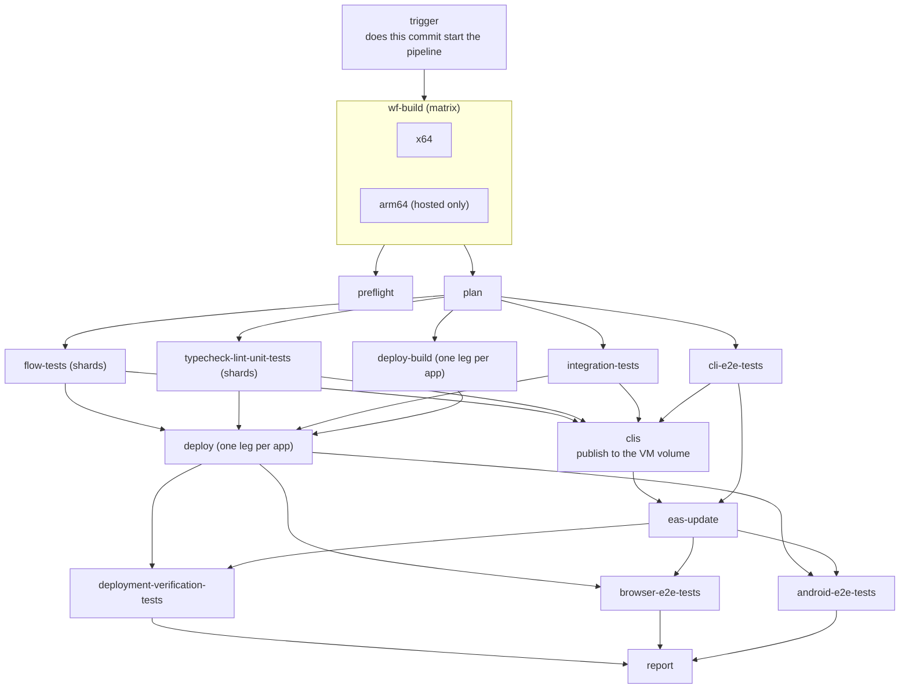
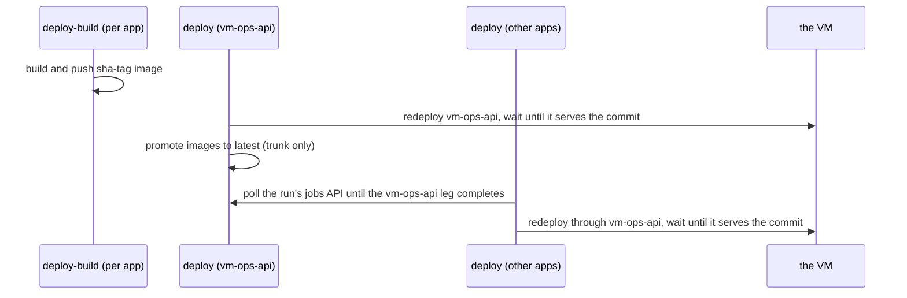

# The CI pipeline

`.github/workflows/pipeline.yml` is one reusable workflow, called by `ci-hosted.yml` ("CI (GitHub-hosted)": ships, deploys, runs the device suites) on every push to `dev` and by `cold-ci.yml` weekly. It runs on GitHub-hosted runners, up to 20 jobs at once (free plan limit). The self-hosted flavor (`deploy.yml`, the VM's own runner, one job at a time) and the VM runner itself were removed on 2026-11-13.

| | |
| --- | --- |
| Test shards | `HOSTED_SHARDS` (default 6) |
| `wf-build` legs | x64 and arm64 |
| Image builds | in parallel, `max-parallel: 20` |
| Deploy legs | one at a time (`max-parallel: 1`): parallel compose pulls on the VM race in containerd's content store (`failed commit on ref ... no such file or directory`) |
| Device | the SDK emulator on the runner (`WF_ANDROID_PROVIDER=emulator`) |

## Job order

Three waves:

1. **Build and plan.** `wf-build` builds this commit's `wf` (the Rust CLI that wraps every `clis/*` crate) once per kind of machine. `preflight` and `plan` run beside each other once it is done.
2. **Tests and builds together.** Flow, typecheck/lint/unit, integration, cli-e2e and the image builds start at once. A build never waits for a test and a test never waits for a check. A red test discards the work already done.
3. **Everything irreversible, then the end-to-end tests.** `clis` publishes binaries, `deploy` redeploys, `eas-update` publishes the phone bundle. All three need green tests. Deployment verification and the browser and Android e2e tests need the deploy and the EAS update.

## What each machine-building job is

- **`wf-build`** builds `wf` for the machine that runs the next jobs. On hosted, the arm64 leg exists because `deploy` runs `wf ship` on `ubuntu-24.04-arm` (it builds the arm64 images the VM runs). It is one matrix job, not two jobs: the legs share every step and differ only in the runner.
- **`clis`** publishes the `wf`, `t3-serve`, `rca-exec` and `wf-mimic` binaries (the ones `wf-build` built, arm64 and x64) as the `wf-latest` release, after the secret-shape scan, with a sha256. It runs only after the tests are green and only when the run ships. A cloud session installs the release with `.agents/setup.sh`.
- **`deploy-build`** builds and pushes the container images of one app (the `build-image` action). Pushing a tag is harmless; moving `latest` happens only in `deploy`, on the trunk.

## Deploy legs

`vm-ops-api` is the first leg because every other leg redeploys through it, and its swap drops their in-flight requests ("Peer disconnected"). The other legs build in parallel and wait only just before their redeploy. On the VM the wait is a no-op because legs already run one at a time.

Image builds fetch the shared libraries from the public libs bucket over plain HTTPS, so a build container on a hosted runner needs no tailnet name or `--add-host` (the registry proxy and `WF_BUILD_ADD_HOSTS` are gone).

## Concurrency groups

- The workflow group is `ci-hosted-<ref>`; the deploy lock is `hosted-deploy-<app>`.
- GitHub replaces a *pending* run in a group and never a running one, so a newer push supersedes a queued run only.
- The deploy lock is per app with `cancel-in-progress: false`: two deploys of one app never overlap, deploys of different apps do.

## Commit tags

| Tag | Effect |
| --- | --- |
| `[services:changed\|all\|a,b]` | which apps get a deploy leg |
| `[cache:yes\|no]` | `no` replays nothing from the Nx and build caches (a cold run) |
| `[ci:...]` | selects stages |

An empty commit with a `[services:...]` or `[cache:...]` tag starts the hosted pipeline (the `trigger` job counts the commit's files through the commits API).

## Measured

Numbers of the first cold hosted run and the VM warm-cache run: `hosted-minutes.md`. The cold hosted run took 1h01 wall and about 190 billed minutes; flow shards are uneven (14 to 23 minutes) because `wf test run --shard i/n` assigns round-robin.

## Not done yet

- One green full cold hosted run of this structure with every deploy leg (tracked in issue #367).
- Cold runs come from the `[cache:no]` commit tag: `wf ci audit` judges a run cold when its head commit carries it (or when it was dispatched by hand). The weekly cold run is `cold-ci.yml` (schedule and dispatch, nothing deployed or shipped): it calls this pipeline with the `fresh` and `services: all` inputs, which do what the `[cache:no]` and `[services:all]` tags do for a commit that carries none, and `wf ci audit` judges a scheduled run cold.

Related: `ci-pipeline-on-the-vm.md` (the VM pipeline in detail), `hosted-minutes.md` (billing and timings), `job-secret-needs.md` (vault scope per job; `clis/secrets/src/data/job-scopes.json`), `cache-layers.md`.
